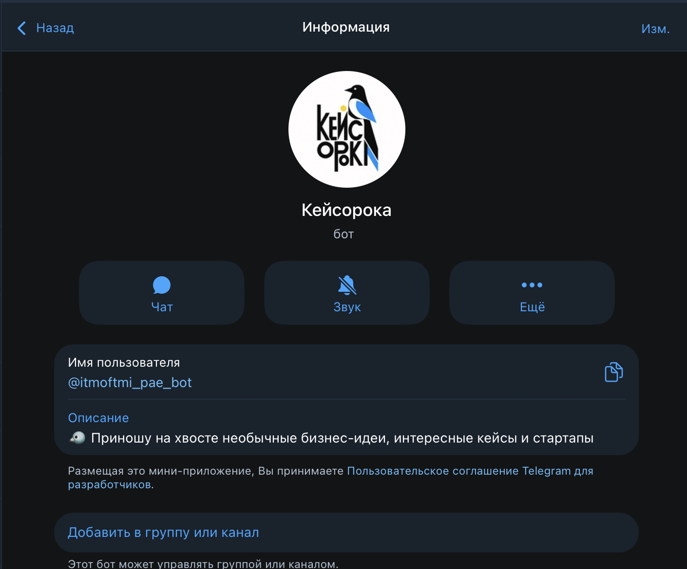
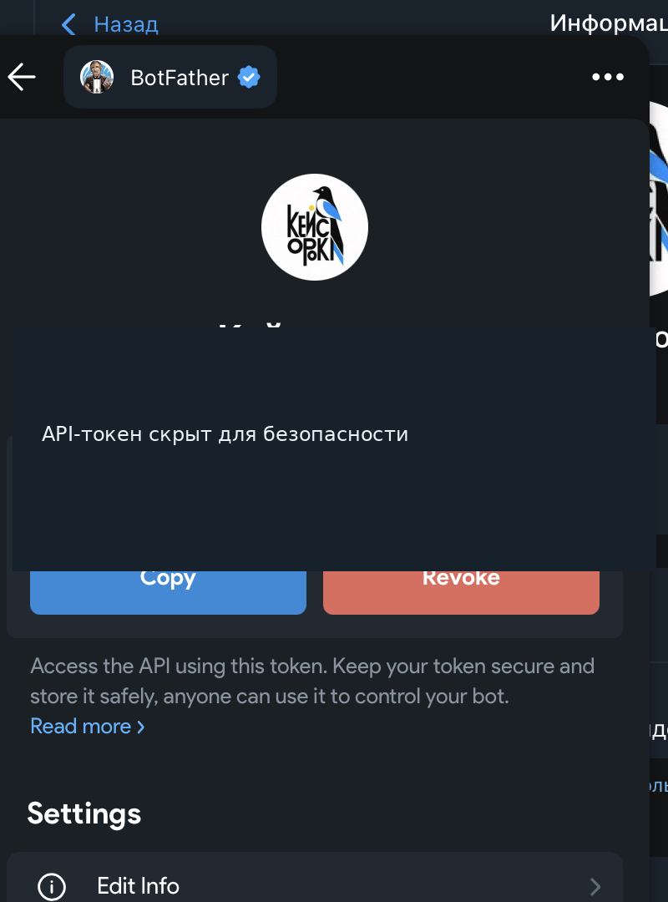
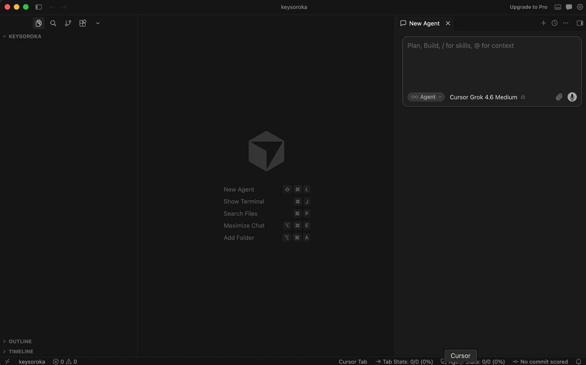
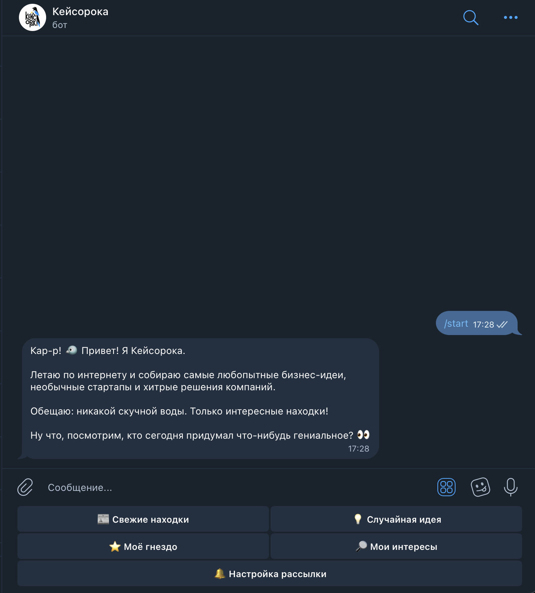
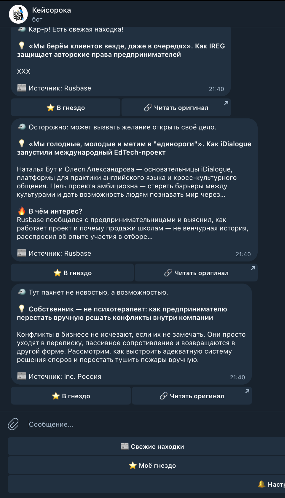
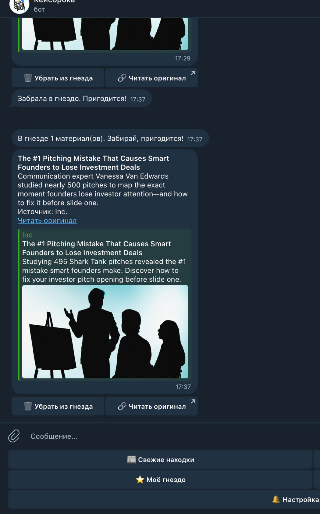
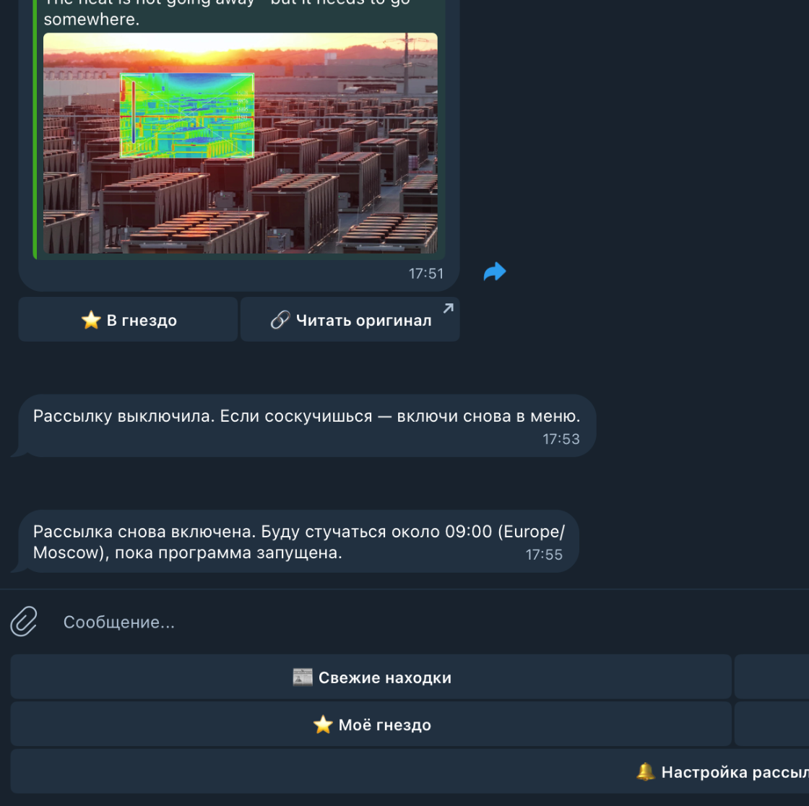

# Лабораторная работа №1. Создание Telegram-бота «Кейсорока» 🐦

University: [ITMO University](https://itmo.ru/ru/)  
Faculty: [FICT](https://fict.itmo.ru)  
Course: [Vibe Coding: AI-боты для бизнеса](https://github.com/itmo-ict-faculty/vibe-coding-for-business)  
Year: 2025/2026  
Group: U4125  
Author: Пушная Алина Евгеньевна  
Lab: Lab1  
Date of create: 12.10.2026

## Идея

Я сделала [Telegram-бота «Кейсорока»](https://t.me/itmoftmi_pae_bot), который собирает новости, бизнес-кейсы и идеи из разных источников. Хотела, чтобы вместо длинных статей можно было быстро посмотреть самое интересное.

*Рисунок 1 — профиль бота в Telegram.*

## Как создавала

Сначала зарегистрировала бота через **BotFather** и оформила название, описание и аватарку. Username — `@itmoftmi_pae_bot`.

*Рисунок 2 — настройка в BotFather (токен скрыт).*

Дальше работала в **Cursor** с Python. С помощью промптов просила ИИ написать бота с RSS-новостями, фильтрацией по интересам, избранным и ежедневной рассылкой. Код дорабатывала и проверяла в Telegram; часть последних исправлений делала с помощью ChatGPT.

*Рисунок 3 — работа над проектом в Cursor.*

## Что получилось

- **Свежие находки** — подборка новостей с коротким описанием и ссылкой на источник.
- **Случайная идея** — одна публикация из базы.
- **Моё гнездо** — сохранение и удаление понравившихся статей.
- **Мои интересы** — отбор новостей по введённым ключевым словам.
- **Настройка рассылки** — включение и отключение дайджеста на 09:00 по Москве.

Новости поступают из RSS-лент, а публикации, избранное и настройки хранятся в **SQLite**.

*Рисунок 4 — приветствие и главное меню.*

*Рисунок 5 — публикации с краткими описаниями.*

## Проверка и исправления

Проверила `/start`, получение новостей, случайную идею, интересы, избранное и переключение рассылки. Настройки сохранялись после перезапуска. Отправку дайджеста ровно в 09:00 отдельно не проверяла.

Не всё получилось с первого раза: попадались англоязычные и не очень подходящие статьи, повторялись новости, иногда встречались пустые или обрезанные описания. После доработки фильтрации и обработки RSS сообщения стали лучше.

*Рисунок 6 — проверка сохранённых публикаций.*

*Рисунок 7 — настройка ежедневного дайджеста.*

## Итог

Получился работающий Telegram-бот. Я научилась создавать бота через BotFather, работать с ИИ в Cursor, запускать Python-проект и проверять его функции. Поняла, что результат ИИ нужно обязательно тестировать и дорабатывать.
