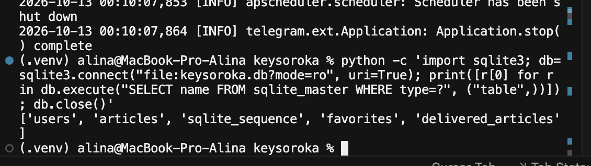
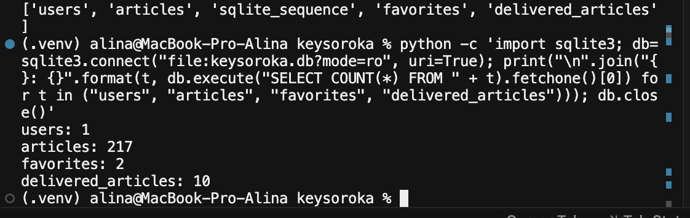
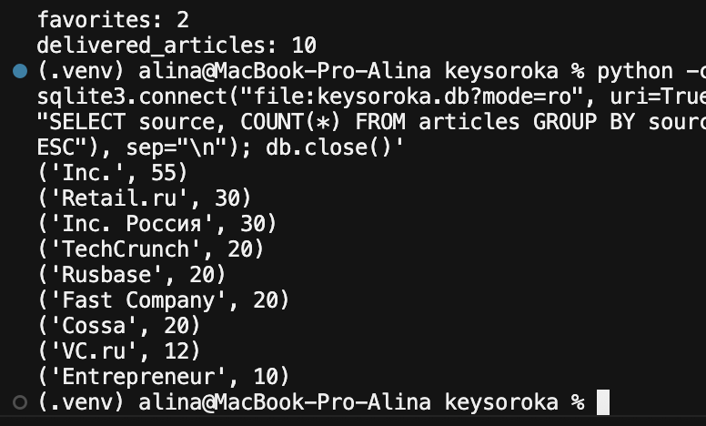

# Лабораторная работа №2. Работа с данными в «Кейсороке»

University: [ITMO University](https://itmo.ru/ru/)  
Faculty: [FICT](https://fict.itmo.ru)  
Course: [Vibe Coding: AI-боты для бизнеса](https://github.com/itmo-ict-faculty/vibe-coding-for-business)  
Year: 2025/2026  
Group: U4125  
Author: Пушная Алина Евгеньевна  
Lab: Lab2  
Date of create: 13.10.2026

## Что проверяла

Для этой работы использовала уже готового [бота «Кейсорока»](https://t.me/itmoftmi_pae_bot). **RSS и SQLite были добавлены ещё в лабораторной №1** — здесь я проверила, как бот получает и сохраняет реальные данные.

RSS даёт новости из деловых изданий, а **SQLite** хранит пользователей, статьи, избранное и историю отправок. RSS — структурированная новостная лента, а не REST API.

## Проверка базы SQLite

В терминале Cursor посмотрела таблицы и количество записей:

| Таблица | Что хранит | Записей на момент проверки |
|---|---|---:|
| `users` | Интересы и настройки пользователей | 1 |
| `articles` | Новости и ссылки | 217 |
| `favorites` | Избранное | 2 |
| `delivered_articles` | История показанных новостей | 10 |

Также есть служебная таблица `sqlite_sequence`.

*Рисунок 1 — список таблиц.*

*Рисунок 2 — результаты подсчёта записей.*

Всего в базе оказалось **217 публикаций из 9 источников**. Это накопленные данные; доступность всех сайтов в момент проверки отдельно не измеряла.

*Рисунок 3 — количество статей по источникам.*

## Проверка фильтра и ошибок

Чтобы проверить поиск без результатов, ввела интерес `несуществующаятема999`. Бот не упал, а сообщил, что ничего подходящего не нашёл, и предложил изменить или очистить интересы.

*Рисунок 4 — реакция на запрос без подходящих новостей.*

Ошибки сети специально не моделировала. Код для RSS и SQLite был создан с помощью ИИ ранее; во второй лабораторной я проверяла существующую интеграцию, не добавляя лишних функций.

## Итог

Я разобралась, откуда берутся новости и как SQLite сохраняет данные. Проверила структуру базы, источники публикаций и обработку пустого результата. Всё работает без отдельной новой интеграции.
