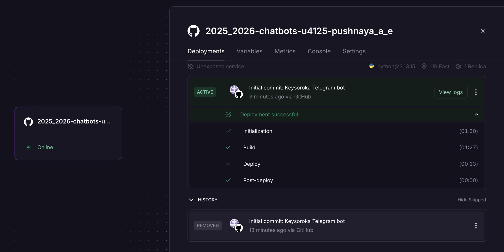
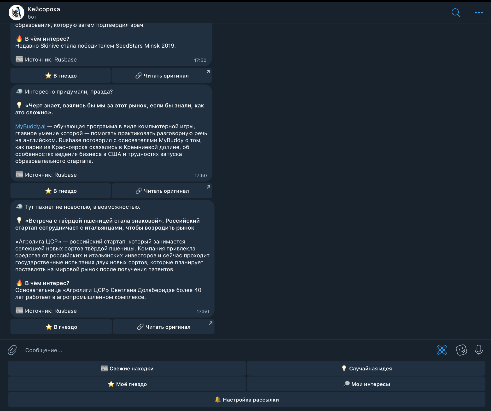
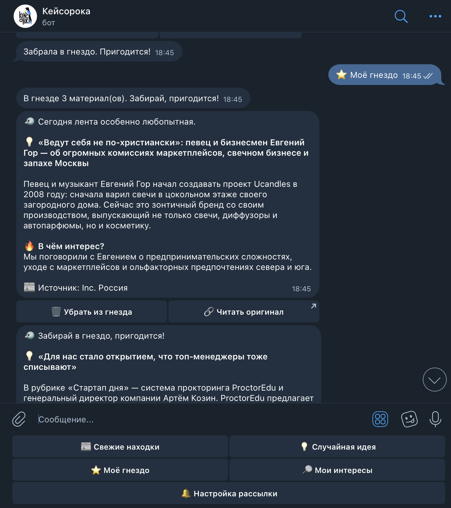
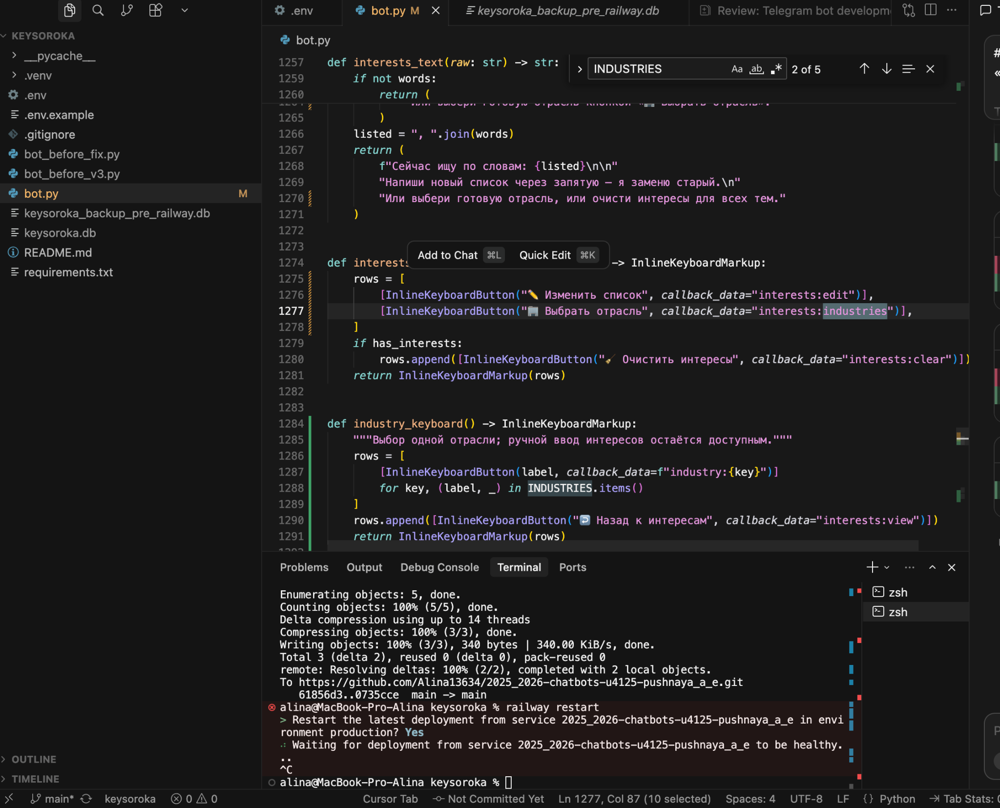
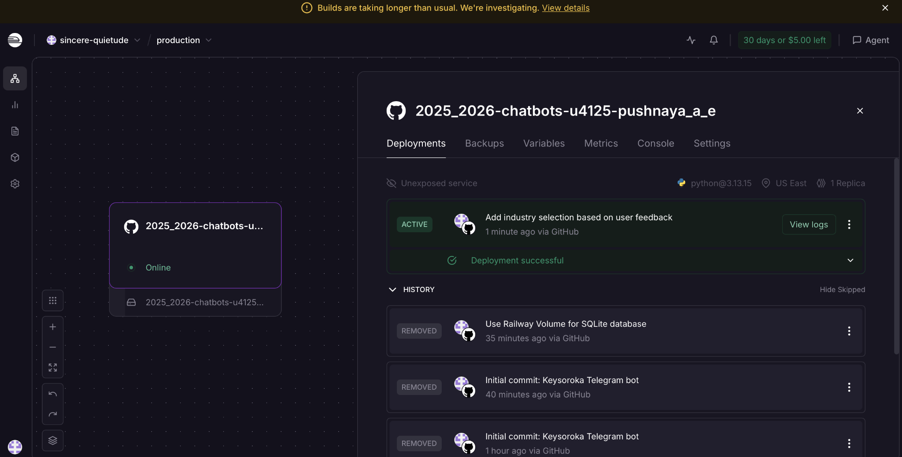

# Лабораторная работа №3. Запуск «Кейсороки» для пользователей

University: [ITMO University](https://itmo.ru/ru/)  
Faculty: [FICT](https://fict.itmo.ru)  
Course: [Vibe Coding: AI-боты для бизнеса](https://github.com/itmo-ict-faculty/vibe-coding-for-business)  
Year: 2025/2026  
Group: U4125  
Author: Пушная Алина Евгеньевна  
Lab: Lab3  
Date of create: 13.10.2026

## Как запустила бота

Для деплоя выбрала **Railway**: бот должен работать без включённого MacBook. Исходный код хранится в [GitHub-репозитории](https://github.com/Alina13634/2025_2026-chatbots-u4125-pushnaya_a_e), а сам бот доступен в [Telegram](https://t.me/itmoftmi_pae_bot).

Загрузила `bot.py` и `requirements.txt` на GitHub, подключила репозиторий к Railway и добавила `BOT_TOKEN` в защищённые переменные. Бот использует **polling**, поэтому отдельный webhook и публичный URL сервиса не понадобились.

*Рисунок 1 — первый успешный деплой, сервис Online.*

## База данных и проверка работы

Чтобы не терять избранное при обновлениях, подключила **Railway Volume** с путём `/data`. Базу SQLite перенесла с MacBook через Railway CLI и установила `DB_PATH=/data/keysoroka.db`.

Проверила `/start`, получение новостей и избранное. После переноса старые **2 сохранённые статьи** остались на месте. Затем добавила третью: после перезапуска бота в гнезде по-прежнему было **3 статьи**.

*Рисунок 2 — бот присылает новости из облака.*

*Рисунок 3 — проверка трёх сохранённых материалов.*

Из сложностей: Railway сначала не видел репозиторий GitHub, а для переноса базы потребовалось настроить SSH-доступ. После исправления разрешений всё подключилось. Использовала пробный доступ Railway на 30 дней или до расходования $5; дальнейшая работа зависит от условий тарифа.

## Отзывы трёх пользователей

После запуска попросила трёх человек проверить бота. По их отзывам:

1. Понравился подбор новостей по своим ключевым словам и понятное меню.
2. Отметили запоминающееся название, навигацию и сохранение публикаций.
3. Предложили добавить **выбор отрасли бизнеса**, чтобы не вводить всё вручную.

Отзывы были получены в переписке, персональные данные тестировщиков в отчёте не публикую.

## Что улучшила

По третьему отзыву добавила кнопку **«🏢 Выбрать отрасль»** в разделе «🔎 Мои интересы». Появились пять вариантов: IT и технологии, торговля и ритейл, маркетинг и реклама, финансы, рестораны и еда. Свои ключевые слова по-прежнему можно вводить вручную.

*Рисунок 4 — добавление выбора отрасли в Cursor.*

Обновление загрузила на GitHub, после чего Railway развернул новую версию. Кнопки проверила в Telegram — работают.

*Рисунок 5 — успешный деплой улучшения по отзыву.*

Повторный отзыв от человека, предложившего функцию: **«Отлично, про это я и говорила. Все шик)»**.

## Итог

Кейсорока работает на Railway, сохраняет данные в SQLite и доступна другим людям. Я научилась загружать проект на GitHub, настраивать деплой и улучшать бота после реального фидбека. В дальнейшем можно наблюдать за стабильностью рассылки и работой сервиса после окончания пробного периода.
